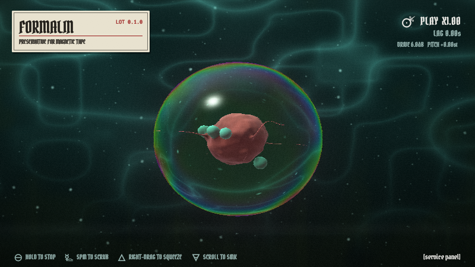
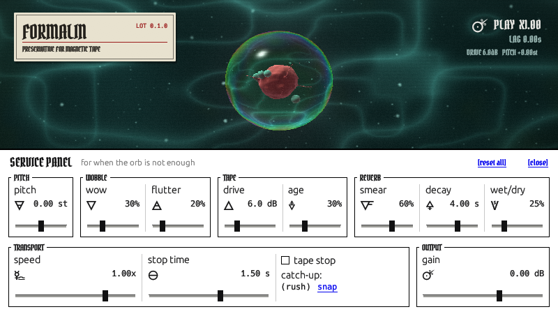

# Formalin

A tape machine you hold in your hand. Formalin is a CLAP and VST3 audio
effect, written in Rust with [nih-plug]: wow and flutter, tape saturation,
pitch shifting, a smeared reverb, and a transport you can grab, stop,
reverse and throw.



```
in -> pitch (pre) -> wow/flutter -> saturation -> reverb -> pitch (post) -> transport -> out
```

## Playing it

The window is a specimen tank holding a glass orb with something alive
inside. The orb's spin *is* the tape speed.

| Gesture | Does |
|---|---|
| Hold the orb | Your grip drags it to a halt: a tape stop under your hand |
| Drag sideways while holding | Scrub; drag left to play backwards |
| Let go | It keeps its momentum, then spins back up and catches up to live |
| Right-drag up/down | Squeeze it (Drive) |
| Scroll over it | Sink or raise it (Pitch) |
| Double-click | Toggle the Tape Stop switch |

The orb writes the automatable **Speed** parameter, so your DAW can record a
performance. Every parameter is also in the **service panel** (bottom right):



## What you see is what you hear

The picture is driven by the same values as the sound:

- **Tape speed:** the tank's caustics, particles and ink all move on tape
  time, so they slow, freeze and run backwards with the audio.
- **Holding the orb:** it becomes a magnet, and the particles snap into
  field lines around it like iron filings.
- **Stopping:** the formalin *fixes*: the water clouds milky from the edges
  in and the creature goes grey and still.
- **Wow / Flutter:** the image sways and jitters like a worn tape.
- **Pitch Position:** pitch applied after the tape slows the whole tank
  down with it, not just the orb.
- **Drive:** the orb flattens, reddens and boils, with heat haze rising off it.
- **Reverb:** the creature bleeds ink into the water in time with the output
  level; Decay sets how long it hangs there.
- **Age:** the water yellows, grime creeps up the glass, and your
  fingerprints stay on it longer.

## Parameters

| Group | Parameter | What it does |
|---|---|---|
| Pitch | Pitch | Real-time pitch shift, -12 to +12 semitones |
| Pitch | Position | Where the shift happens: *pre* (before the tape, so the reverb tail isn't pitched), *post* (after the reverb, so the whole room is pitched), or split between the two |
| Wobble | Wow / Flutter | Slow wobble and fast jitter of tape speed |
| Tape | Drive / Age | Asymmetric tape saturation / high-frequency loss of worn tape |
| Reverb | Smear / Decay / Wet-dry | Diffused reverb: blur, decay time (RT60), and the reverb's own wet/dry mix |
| Transport | Speed | Read-head speed, -2x to 2x (the orb). Below 1x falls behind live |
| Transport | Stop Time / Tape Stop | Coast the transport to a halt; automate it for drops |
| Transport | Catch-up | After slowing down: *Rush* plays fast until it's caught up, *Snap* crossfades straight back to live |
| Output | Gain | Output level |

There is no global dry/wet: Wet-dry only blends the reverb.

## Building

You need a recent stable [Rust toolchain](https://rustup.rs). Then:

```sh
cargo xtask bundle formalin --release
```

This writes `Formalin.vst3` and `Formalin.clap` to `target/bundled/`.

**Linux** also needs these development packages (Debian/Ubuntu names):

```sh
sudo apt install libasound2-dev libgl-dev libjack-dev libx11-xcb-dev libxcb1-dev \
  libxcb-dri2-0-dev libxcb-icccm4-dev libxcursor-dev libxkbcommon-dev \
  libxcb-shape0-dev libxcb-xfixes0-dev
```

**macOS:** to build one bundle for both Apple Silicon and Intel Macs:

```sh
rustup target add aarch64-apple-darwin x86_64-apple-darwin
cargo xtask bundle-universal formalin --release
```

## Installing

Copy the bundles from `target/bundled/` into your plugin folders, then
rescan plugins in your DAW.

| Platform | VST3 | CLAP |
|---|---|---|
| Windows | `C:\Program Files\Common Files\VST3\` | `C:\Program Files\Common Files\CLAP\` |
| macOS | `~/Library/Audio/Plug-Ins/VST3/` | `~/Library/Audio/Plug-Ins/CLAP/` |
| Linux | `~/.vst3/` | `~/.clap/` |

On macOS the bundles aren't code-signed. If you download a build rather
than compiling it yourself, macOS may refuse to load it; clear the
quarantine flag first:

```sh
xattr -dr com.apple.quarantine ~/Library/Audio/Plug-Ins/VST3/Formalin.vst3
```

Formalin is VST3 and CLAP only, with no AU or AAX, so it won't load in Logic
Pro or Pro Tools. The window needs OpenGL 3.2.

**Tested on:** Windows 11 with FL Studio. macOS and Linux builds are checked
by CI but haven't been tried in a host yet; reports are welcome.

## Fonts

Formalin bundles two fonts under the [SIL Open Font License](https://openfontlicense.org):
[Pirata One](https://fonts.google.com/specimen/Pirata+One) for display text
and [Noto Sans Symbols](https://fonts.google.com/noto/specimen/Noto+Sans+Symbols)
for the alchemical symbols. Their licenses are in `assets/fonts/`.

To use different fonts in your own builds, see
[`assets/fonts/private/README.md`](assets/fonts/private/README.md).

## Development

```sh
cargo test --lib                                      # DSP unit tests
cargo run --features standalone --bin formalin_standalone -- --backend dummy
```

The second command opens the plugin as a desktop app, so you can work on the
UI without a DAW. In debug builds, set `FORMALIN_PREVIEW` to any of
`panel,still,rew,held,hot,aged` to force those states for screenshots.

```
src/lib.rs        plugin glue: nih-plug traits and the process loop
src/params.rs     parameters (don't change their #[id]s: hosts save them)
src/dsp/          the DSP, one file per effect, plain Rust with no nih-plug types
src/meters.rs     lock-free values the audio thread publishes for the GUI
src/editor/       the window: orb.rs (physics and gestures), gl.rs (three
                  render passes), shaders/ (GLSL 150), panel.rs, style.rs
```

## License

Formalin is licensed under the [GNU GPL v3.0 or later](LICENSE). VST3 builds
link against GPLv3 code (the VST3 bindings used by nih-plug), so the GPL
applies to them.

[nih-plug]: https://github.com/robbert-vdh/nih-plug
